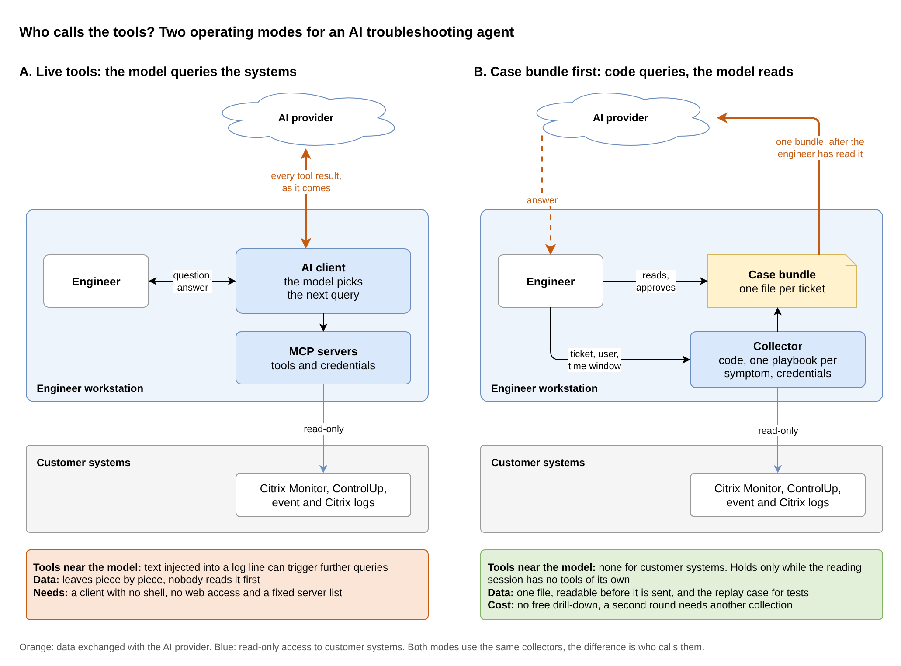

On 3 October I wrote in my design notes that Citrix had no official MCP server for on-prem Monitor data, and that I would have to build one. Sixteen days later Citrix documented one. That was the first thing I got wrong about an AI agent for Citrix troubleshooting, and the least important.

The important one sat in the first line of the design: "Strictly read-only." I treated that as the safety property. Three reviews later it is the smallest problem on the list, and not even that one is closed.

## What the agent is supposed to do

A slow-logon ticket sends me through Director, ControlUp, the hypervisor console, sometimes NetScaler Console, and the event logs of one VDA. The agent would pull the same data for one user, one machine and one time window through MCP servers, correlate it, and hand back a hypothesis with the evidence, what it ruled out and what it could not check. It never changes anything. I decide, and I make the change.

None of this is built. This post is about a design and three critical reviews of it, two done with Claude and one with ChatGPT, all on paper. No lab has confirmed a single line yet. The compliance side, customer data going to an AI provider, is its own topic and not in this post.

**Applies to**

- Citrix Virtual Apps and Desktops on-prem, 2402 LTSR and later (official Citrix DaaS MCP Server Local)
- ControlUp Real-Time DX 9.2.5 or later with the ControlUp MCP server
- Citrix Always On Tracing with an AOT Log Server
- Claude Code as the MCP client for the client-side controls

## Read-only protects the systems, not the data

A read-only agent cannot break a Delivery Controller. It can still do four other things.

It can put customer data into a web request because a log line told it to. It can query customer B while it works on a ticket for customer A. It can hit the Monitor database with wide OData queries in the middle of the morning logon peak. And it can drift from troubleshooting into watching what individual users do all day.

A read-only service account stops none of these. Each needs its own control, and "the agent is instructed not to" is not a control. Event messages, process names and client-side logs are text that somebody else wrote, and the model reads all of it.

Read-only itself is not proven either. The security section of the Citrix docs for the official server asks for domain administrator credentials, while the prerequisites ask for a domain user with a Citrix administrator role. The ControlUp API offers write calls next to the read calls. Until a lab shows that a read-only account is enough for both, "read-only" is an intention.

## The controls I had promised

My draft had answers for the four risks: field filtering at the MCP layer, an audit line for every call, a ticket reference for every per-user query, one client profile per customer. The first review went through them one at a time and asked where each one is enforced.

Most of them were enforced nowhere.

The vendor MCP servers I planned to use do not write my audit log, and they do not know which engineer or which ticket a call belongs to. A tool allowlist can block a tool. It cannot remove a field from a result. The official Citrix server has a generic tool, `run_dynamic_odata`, that runs any Monitor query and returns up to 10,000 rows, and with that tool blocked the others still return UPN, full name and IP addresses. My ticket rule lived in the agent's instructions and in no tool signature, so it was a sentence in a prompt and nothing more.

Then the client. I had blocked web search, mail and other connectors, and never mentioned the client's own shell and file tools. In Claude Code those are the main tools. The MCP servers run as the same Windows user as the client, and the official Citrix server keeps its Delivery Controller credential in that user's Credential Manager. My design said the agent never sees credentials. A shell running as that user can read them.

The risk table in the draft said this about the agent changing something on a customer system: "Not possible by design." That sentence is gone.

Fixes exist, at least for Claude Code. A managed MCP file loads only the listed servers. Managed permission rules remove the shell, web and write tools from the model. A small proxy in front of the vendor servers filters fields, writes the audit line and refuses per-user tools until a case with a ticket reference is open. None of it is tested, and all of it is more work than creating a read-only service account.

## Free text ignores field filters

The second review found a hole in the fix. I had promised to keep window titles, URLs, command lines and document names away from the model. For structured fields that works: the server does not return the field.

The logs the agent needs most are free text. An FSLogix event carries the path of the profile container, user name included. An Always On Tracing line carries whatever the component wrote. A field filter touches none of it. Scrubbing known patterns such as UNC paths, UPNs and SIDs helps, and replacing the names of the case with placeholders helps more. It stays best effort. I would rather write that into the design than promise a clean separation I cannot show.

## The example that did not add up

My sample answer for a slow logon said: 62 seconds for the user, a peer median of 19 seconds, and 9 of 14 peers in the same hour with more than 30 seconds of profile load. If nine of fourteen logons spend over 30 seconds in profile load alone, the median cannot be 19. I wrote the example and did not see it.

The arithmetic error sat on top of a design error. Comparing a user with peers in the same hour answers "is it only this user?". During a shared incident the peers are slow too, and the comparison hides the problem. "Is this abnormal?" needs a second number: the same delivery group, the same weekday and hour, in previous weeks.

The same example claimed that three sources agreed. Three of its findings came from ControlUp. Three tools on one agent are one source. And a 5-minute average from a hypervisor can support a cause, but it cannot rule out a 30-second contention spike. "Ruled out" needs data at least as fine as the event it is ruling out.

## Maybe the model should not hold the tools

The second review asked the question I had skipped. Why does the model call the tools at all?

For a slow logon the steps are known. Code can run them and write everything for user, machine and window into one case bundle. The model reads the bundle and nothing else. That shrinks three problems instead of solving them one by one: no credentials near the model, no customer systems for an injected instruction to query, and one file I can read before it goes to the provider. It only holds while the session that reads the bundle has no tools of its own. A chat client with web search or a mail connector is still a way out. The bundle is also the test case for the next model version, and it is a usable correlation report with no AI involved at all. It is also the one interface every AI client can take, with or without MCP.

{: w="800" }
_Live tools versus case bundle. The collectors are the same, the difference is who calls them and what the model can reach._

The objection is obvious and it is a good one. Following a lead is what an agent is good at: the FSLogix event points at the file server, so look at the file server. A fixed bundle cannot do that. A second collection round that I approve can, but it is slower, and I do not know whether a playbook per symptom collects enough for the cases that matter. That is a lab question. My plan is to build the collectors so that both modes work, and to start with the bundle.

## A different model read it differently

After the second review I gave the design to ChatGPT. I expected overlap with the first two. It came back with twelve new findings, four of them blockers.

The sharpest one went back to the example. Two reviews had fixed its arithmetic and its source counting, and the corrected version said: evidence level high, the cause is latency on the profile share. The third review asked what the evidence shows. Profile load was slow. FSLogix retried the attach. Share latency was up in the same minutes, and the baseline says none of this is normal. All of that confirms the symptom. None of it tells storage latency from an SMB problem, an authentication delay or a locked container. My evidence levels had rewarded sources for agreeing with each other, as if agreement proved a cause. The answer now says "associated with", and "caused by" only where the mechanism itself was observed.

"Ruled out" went the same way. I had tied it to an empty result from a source that would have recorded the problem. Group Policy can be slow without writing one error event, so an empty error query proves that there were no errors and nothing more. The default is now "no supporting evidence observed". "Ruled out" stays for the few hypotheses with a tested detection rule behind them.

It also took apart a fix from the first review. The ticket gate records which ticket an engineer claimed. It does not check that the ticket exists, that it belongs to this customer or that it covers this user. That is an audit trail, and I had called it authorization.

Then the vendor facts. Several statements written into the design that same day were wrong or out of date. ControlUp now hosts a read-only MCP server of its own. XenServer keeps a minimum and a maximum per hour next to the average. For hosted AI clients the vendors document private routes to an MCP server, so a public endpoint is not the only way in. I checked each correction against the vendor docs, and each one held.

## Where this leaves the design

The three reviews produced 41 findings, nine of them blockers. None says the idea is wrong. They say I had described controls as if writing them down made them exist.

Three things I would tell anyone starting the same design. Build as little as possible. Citrix overtook my custom server in 16 days, and since 22 October Aidrien parses Always On Tracing logs for DaaS customers. What no vendor will ship is the join across Citrix Monitor, ControlUp, Windows events and the hypervisor for on-prem sites, so that is the only part worth owning. And do not design the controls around one AI client. Most of my client-side fixes are Claude Code settings. I want to start with Claude, but the setup has to work with Microsoft 365 Copilot and ChatGPT as well, and Copilot Studio and ChatGPT on the web reach an MCP server only from their vendor's cloud. So the controls move to the two places every client has to pass: the proxy and the bundle. And have a different model read the result. The first two reviews and I had agreed on an evidence scheme that the third took apart in one paragraph, and the newest errors in the design were the ones made while fixing the older ones.

The next step is a lab with synthetic users, where the open questions get answers instead of paragraphs.

## Related

- [HDX Connection Time, the Logon Phase You Should Be Checking](/posts/citrix-hdx-connection-time-rendezvous/) - a logon phase analysis done by hand, the kind of correlation the agent is meant to prepare
- [My Second Brain: Claude, Obsidian and Git](/posts/second-brain-architecture/) - the design note and all three reviews live in the vault that post describes

## Sources

- [Citrix DaaS MCP Server Local, Citrix Aidrien docs](https://docs.citrix.com/us/en/citrix-aidrien/citrix-daas-mcp-local.html)
- [Citrix Aidrien, What's new](https://docs.citrix.com/en-us/citrix-aidrien/whats-new)
- [Introduction to Always On Tracing, Citrix Always On Tracing 2607 LTSR](https://docs.citrix.com/us/en/citrix-always-on-tracing/2607-ltsr/introduction.html)
- [ControlUp MCP Server, ControlUp Support](https://support.controlup.com/docs/mcp-server)
- [ControlUp API Reference](https://api.controlup.io/reference)
- [Configure permissions, Claude Code docs](https://code.claude.com/docs/en/permissions)
- [Control MCP server access for your organization, Claude Code docs](https://code.claude.com/docs/en/managed-mcp)
- [Connect your agent to an existing MCP server, Copilot Studio, Microsoft Learn](https://learn.microsoft.com/en-us/microsoft-copilot-studio/mcp-add-existing-server-to-agent)
- [ChatGPT MCP: Setup, Plans, and Limits (2026), Coworker](https://coworker.ai/blog/chatgpt-mcp)
- [Secure MCP Tunnel, OpenAI developer docs](https://developers.openai.com/api/docs/guides/secure-mcp-tunnels)
- [Use Virtual Network support for agent calls to private endpoints, Copilot Studio, Microsoft Learn](https://learn.microsoft.com/en-us/microsoft-copilot-studio/admin-network-isolation-vnet)
- [Monitor and manage your deployment, XenServer 8 docs](https://docs.xenserver.com/en-us/xenserver/8/monitor-performance)

---

 

*Checked against the vendor documentation in November 2026. Nothing in this post has been tested in a lab.*

 

*Designing an agent like this, or already running one against Citrix data? Reach out on [LinkedIn](https://www.linkedin.com/in/robertmagasi/).*

 

> *This post was written with assistance from Claude (Anthropic) as a drafting and editing tool. All technical content, solutions, and recommendations reflect my own hands-on experience and professional judgment.*
